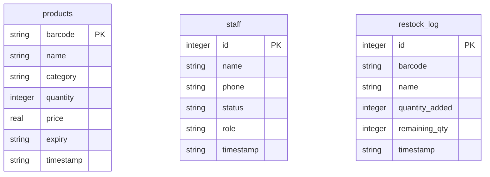

# Project Features Tracker: Inventory Management & POS

This is the centralized tracking document for the Store Inventory and POS application. It serves as the master checklist, architecture outline, and documentation log for all features in the system.

---

## 🏗️ Architecture Overview

> [!NOTE]
> *Update this section as the database schema, folder structures, or technical stack configurations change.*

### Technical Stack
- **Frontend / UI**: CustomTkinter (Python desktop GUI framework)
- **Database**: SQLite3 (Local single-file database)
- **Programming Language**: Python 3.14+

### Database Schema Draft

---

## 🚦 Module Status Summary
- **Inventory Management**: 🟢 Completed
- **Sales & Checkout (POS)**: 🟡 In Progress
- **Restock & Supply Chain**: 🟡 In Progress
- **Analytics & Reports**: 🟡 In Progress
- **Staff & HR**: 🟢 Completed

---

## 🛠️ Core Modules (Task Checklist)

### 1. Inventory Management 🟢 Completed
*Tracks product info, categories, and expiry metrics.*

#### UI / Frontend Tasks
- [x] Product table Treeview layout with name, category, quantity, price, expiry, and barcode columns.
- [x] Center-align all table columns and headings.
- [x] Barcode column moved to the far right, Name column moved to the far left.
- [x] Product Dialog modal containing inputs for name, category, quantity, price, and expiry date.
- [x] Multi-dropdown Expiry Date Picker (Day, Month, Year selectors) with manual input support.
- [x] Auto-mapping typed month numbers to abbreviated names (e.g. `5` -> `May`).
- [x] Month number clamping (typing `0` or below maps to `Jan`; typing `>12` maps to `Dec`).
- [x] Auto-formatting typed days to 2 digits (e.g. `5` -> `05`).
- [x] Low-stock alert indicators (orange highlighting for items with quantity < 5).
- [x] Live search filter for Name, Barcode, and Category.

#### Logic / Data Tasks
- [x] Local SQLite `products` table creation and setup.
- [x] Schema migration to automatically append new columns (e.g. `expiry`) on startup.
- [x] CRUD logic methods for adding, reading, updating, and deleting products.
- [x] Export current inventory data to a CSV file.

---

### 2. Sales & Checkout (POS) 🟡 In Progress
*Handles scanning, shopping cart, transactions, and refunds.*

#### UI / Frontend Tasks
- [x] POS view layout with checkout item details.
- [x] Focus automation on the barcode entry field for continuous barcode scanner inputs.
- [x] Add to Bill modal popup for quantity entry.
- [ ] Payment method selection UI (Cash vs. Card toggle).
- [ ] Refund/Return processing interface.
- [ ] Receipt print preview layout.

#### Logic / Data Tasks
- [x] Shopping cart session generation and price totals calculation.
- [x] Inventory level subtraction logic upon completed sale.
- [ ] Log completed transactions to a `sales_log` table with payment method info.
- [ ] Return and refund transaction calculation and rollback logic.

---

### 3. Restock & Supply Chain 🟡 In Progress
*Handles incoming inventory, logs, and supplier details.*

#### UI / Frontend Tasks
- [x] Restock history log Treeview.
- [ ] Low-stock dashboard layout listing sold-out and low-stock items.
- [ ] Supplier Database UI (tables for names, phone numbers, catalogs).

#### Logic / Data Tasks
- [x] Transaction insertion logic to log incoming quantities to `restock_log`.
- [ ] Email/Notification trigger logic for low-stock products.
- [ ] Supplier table mapping and search endpoints.

---

### 4. Analytics & Reports 🟡 In Progress
*Calculates sales figures, revenue, and daily performance metrics.*

#### UI / Frontend Tasks
- [x] Sales history log view.
- [ ] Revenue dashboard layout with aggregate sales statistics.
- [ ] End-of-day reconciliation modal.

#### Logic / Data Tasks
- [x] Retrieve transaction histories filtered by date.
- [ ] Aggregate logic calculating daily net margins and tax percentages.
- [ ] Automatic end-of-day database backup.

---

### 5. Staff & HR 🟢 Completed
*Shift tracking, cash balancing, and employee records.*

#### UI / Frontend Tasks
- [x] Staff Management sidebar page.
- [x] Staff table Treeview displaying Name, Phone, Role, Status, and Date.
- [x] Center-align all staff columns and headings.
- [x] StaffDialog modal for adding and editing staff details.
- [x] Status bar displaying total staff counts and currently working staff metrics.
- [x] Search filter for name, phone, or role.

#### Logic / Data Tasks
- [x] SQLite `staff` table creation with status and role parameters.
- [x] CRUD operations for adding, updating, and deleting staff records.
- [ ] Cashier shift session logging (clock-in, clock-out, starting till, ending till).
- [ ] Role-Based Access Control (Admin vs. Cashier view rendering toggles).

---

## 🚀 Phase 2 / Backlog (Future Expansions)
- [ ] **Custom Storefront Sync API**: Endpoints to sync local inventory levels with an external WooCommerce/Shopify e-commerce store.
- [ ] **Loyalty Program**: Customer profiles tracking total spend, reward points, and auto-applying discounts at POS.
- [ ] **Automated Purchase Orders**: Generates and emails PDF purchase order proposals to suppliers when items hit their low-stock thresholds.

---

## 🚫 Out of Scope (Excluded Features)
*The following features are excluded to maintain focus and prevent scope creep:*
- **AI Demand Forecasting**: No machine learning calculations for predicted demand.
- **Full CRM Suite**: No marketing campaigns, ticket support, or lead flows.
- **Live Fleet Tracking**: No delivery driver vehicle maps or GPS coordinate logging.
- **Manufacturing & BOM Tracking**: No raw material recipe assembly or multi-stage factory job tickets.
